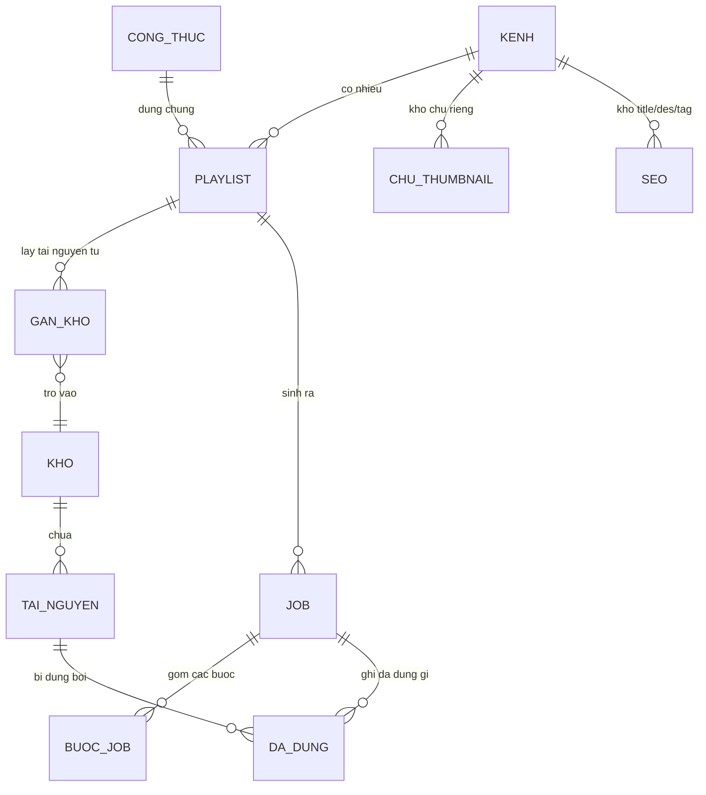
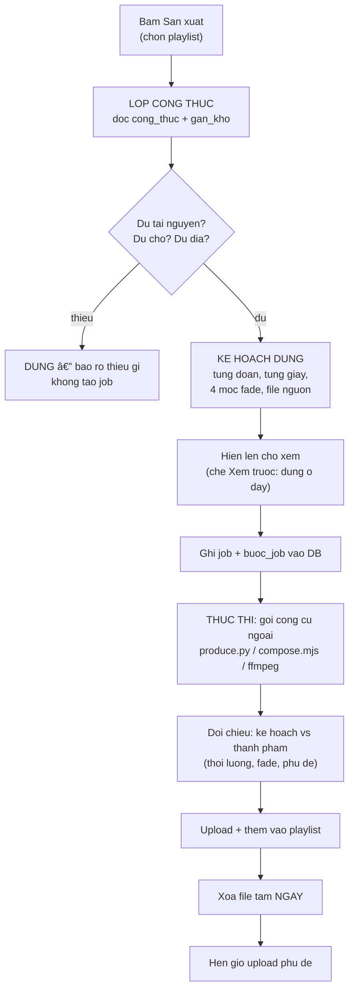

# THIẾT KẾ APP MỚI — "YOUTUBE CONTENT FACTORY"
Ngày 27/09/2026 · thay cho `apps\youtube-automation-studio` (app cũ **giữ nguyên, vẫn chạy**)

## ✅ ANH VŨ �à CH�T (21:47 27/09/2026)
| Quyết định | Chốt |
|---|---|
| Tên app + thư mục | **YouTube Content Factory** → `apps\youtube-content-factory` |
| Ngôn ngữ trong code | **Tiếng Anh** (bảng: `channel`, `playlist`, `recipe`, `asset_pool`, `asset`, `thumbnail_text`, `seo_item`, `job`, `job_step`, `usage_log`, `tool`, `config_history`) |
| Thứ tự thi công | **Tuần tự M1→M6** |
| Phạm vi | 5 việc đã nêu + **các tính năng §7 TRỪ 3 mục anh gạch đ�** (cập nhật 22:21 27/09, ảnh chụp PDF) |
| Giao diện + tài liệu | Vẫn **tiếng Việt** (chỉ code là tiếng Anh) |

### Phạm vi tính năng §7 sau khi anh gạch đ� (22:21 27/09)
| Mục | Quyết định |
|---|---|
| ~~A1 Cổng chặn phụ đ� bằng máy~~ | **B�** (anh gạch). Phụ đ� vẫn bắt buộc theo quy tắc 14/09; việc kiểm nằm trong A4 đối chiếu, nhưng KHÔNG làm cổng chặn upload riêng |
| A2 Canh đĩa + d�n cuốn chiếu | **LÀM** |
| A3 Chạy tiếp chỗ dở | **LÀM** |
| A4 �ối chiếu thành phẩm vs kế hoạch | **LÀM** (th�i lượng, fade, phụ đ�, độ to) |
| A5 Một job một lúc | **LÀM** |
| B1 Lịch tự chạy | **LÀM** |
| ~~B2 Cảnh báo kho gần hết~~ | **B�** (anh gạch). Vẫn HIỂN THỊ "còn bao nhiêu chưa dùng" ở trang playlist (§5.2) — chỉ b� phần báo động chủ động |
| ~~B3 Hoãn phụ đ� trong app~~ | **B�** (anh gạch). Giữ cơ chế hiện tại (Windows Scheduled Task theo chuẩn TOOLS.md: /RU SYSTEM + StartWhenAvailable) |
| B4 Nhân bản playlist | **LÀM** |
| B5 Xem thử thumbnail thật | **LÀM** |
| Nhóm C (C1 hiệu suất · C2 chấm điểm · C3 chi phí gi�) | **B�** (anh chốt 22:26 27/09) |

Tên bảng ở §3 viết theo lối Việt để dễ đ�c — khi thi công dùng tên Anh theo bảng quy đổi trên.

---

## 0. Cách đ�c tài liệu này
- Mỗi khẳng định v� app cũ đ�u **kèm bằng chứng đã chạy lệnh**. Chỗ chưa kiểm em ghi rõ *"chưa kiểm"*.
- Phần **§1 Bệnh → Thuốc** là lý do phải viết lại. Nếu anh không đồng ý phần này thì đừng đ�c tiếp,
  vì toàn bộ thiết kế dựa trên nó.
- Phần **§9** là thứ tự thi công và cách nghiệm thu từng mốc.

---

## 1. BỆNH CỦA APP CŨ → THU�C TRONG APP MỚI

App cũ: **100 file · 18.358 dòng** (đã đếm). Không phải nó tệ — nó **m�c thêm** qua nhi�u vòng vá
nên có hai bộ xương chồng nhau.

| # | Bệnh (đã kiểm chứng) | Bằng chứng | Thuốc trong app mới |
|---|---|---|---|
| **B1** | **Hai mô hình dữ liệu cho cùng một thứ.** `presets.json` (khoá tiếng Anh, theo **KÊNH**) và `playlists.json` (khoá tiếng Việt, theo **PLAYLIST**) chứa **trùng nội dung**: cùng tả kho nhạc, kho hình, thumbnail, phụ đ�, quy�n riêng tư. Sửa một bên không sang bên kia | dump schema 2 file: `presets.alta.audioLibraryPool` ↔ `playlists[0].congThuc`, `thumbnail.line1` ↔ `thumbnail.dong1` | **Một bảng duy nhất** trong SQLite. Xoá hẳn khái niệm "preset theo kênh" |
| **B2** | **Hai bộ danh sách kênh.** `channels.json` (khoá Anh) và `channels-v2.json` (khoá Việt) cùng 6 kênh | cả 2 file cùng tồn tại, cùng 6 mục | Một bảng `kenh` |
| **B3** | **Hai engine song song, một cái chưa từng chạy thật.** `cong-thuc.mjs` (lớp công thức tử tế, có `fadeOutGiay ?? 15`, tả đuôi theo kiểu) **chỉ phục vụ nút Xem trước**. �ư�ng sản xuất thật đi `pipeline.mjs` → đ�c `presets.json` | `pipeline.mjs` import: `playlists.mjs`, `presets.mjs` — **không có** `cong-thuc.mjs`. `server.mjs:18` import `chuan-bi-video` chỉ cho `/xem-truoc` + `/chong-lap` | **Một engine.** Công thức sinh ra **kế hoạch dựng**; không có đư�ng nào dựng video mà không qua kế hoạch |
| **B4** | **Fade bị mất vì rơi ở ranh giới 4 lớp.** Chuỗi g�i: `pipeline.mjs` → `scripts\bridge\produce-hybrid-4h.mjs` → `skills\...\produce.py` → `skills\video-compose\compose.mjs`. Nhánh podcast truy�n `--fade-out`, nhánh 4 gi� **không** | `produce-hybrid-4h.mjs:63` tr� `produce.py`; `produce.py:21` tr� `compose.mjs`; đo video 4h thật: cắt phựt ở −34 dB | **Tham số dựng là MỘT bản ghi** đi suốt, không truy�n tay từng c� dòng lệnh. Thiếu tham số = **lỗi lúc lập kế hoạch**, không phải âm thầm b� qua |
| **B5** | **Cấu hình nói một đằng, bộ dựng làm một nẻo.** Cả 5 playlist khai đuôi `nhacKhongVoice`, nhưng script hard-code màn đen 7.200 s | `playlists.json` m�i mục: `duoi:[{kieu:"nhacKhongVoice"}]`; `produce-hybrid-4h.mjs` dựng `color=c=black` | Kế hoạch dựng **in ra được và so được với thành phẩm**; có bước đối chiếu "định làm gì / đã làm gì" |
| **B6** | **Playlist là hạng hai nên kênh hiện 2 lần.** �ơn vị chính là KÊNH; PQTA có 2 playlist → giao diện vẽ 2 thẻ kênh y nhau | anh Vũ thấy trên giao diện; `presets.json` có cả `pqta` và `pqta-4h` như 2 "kênh" | **Cây Kênh → Playlist.** Kênh chỉ giữ thông tin tài khoản; **m�i cấu hình sản xuất nằm ở playlist** |
| **B7** | **Không có CRUD tài nguyên.** Kho trên D: chỉ đ�c; muốn thêm/xoá/sửa thẻ phải sửa file tay | `server.mjs` chỉ có `GET /api/kho`, không có POST/PUT/DELETE | Kho vào **chỉ mục SQLite**, có thêm/sửa/xoá/gắn thẻ/ẩn, có bút toán ai sửa lúc nào |
| **B8** | **Trạng thái job nằm trong RAM.** `activeJob`, `cascadeState` là biến trong tiến trình → restart là mất, không biết đang dở ở đâu | `pipeline.mjs:61` `export const activeJob = {...}` | **Hàng đợi ghi DB.** Mỗi bước ghi mốc → restart đ�c lại, chạy tiếp chỗ dở |
| **B9** | **Bản `.bak` lẫn trong thư mục chạy.** 12 file `.bak-*` / `.truoc-*` nằm cùng chỗ với file thật, có file 533 dòng | `pipeline.mjs.truoc-va-task`, `app.js.bak-truoc-playlist`, `playlists.json.truoc-dien-pqta-...` | **Không có `.bak` trong thư mục chạy.** Lịch sử nằm trong git + bảng `lich-su-cau-hinh` |
| **B10** | **Bản sao chết gây sửa nhầm.** `apps\...\patches\compose.mjs` hash **trùng y** bản thật nhưng **không ai g�i** | hash cả hai = `891A12F5…`, 15.082 byte; `produce.py:21` g�i bản trong `skills\` | Mỗi công cụ ngoài khai **một đư�ng dẫn duy nhất** trong DB, app tự kiểm tồn tại lúc khởi động |

### Ràng buộc cứng của máy này (đã kiểm, không ph�ng đoán)
| Ràng buộc | Bằng chứng | Hệ quả thiết kế |
|---|---|---|
| **npm h�ng**, app cũ không có `package.json`/`node_modules` | `npm -v` → `Cannot find module npm-prefix.js` | **Zero-dependency.** Chỉ `node:*` stdlib. Không framework, không bước build |
| **`node:sqlite` chạy được** | đã tạo bảng, ghi, đ�c lại thành công trên node v22.22.1 | Có SQLite thật mà **không cần cài gì** |
| Shell là **PowerShell**, backtick là ký tự thoát | đã sập 1 lần ngay trong buổi này | Lệnh dài viết vào file `.mjs`/`.ps1` rồi chạy, không nhồi inline |
| ffmpeg ở `C:\ffmpeg\ffmpeg.exe`, chưa trong PATH | TOOLS.md + đã dùng | �ư�ng dẫn công cụ ngoài **khai trong DB**, không giả định PATH |

---

## 2. BA NGUYÊN TẮC CỦA APP MỚI

**N1 — Một nguồn sự thật.** M�i cấu hình nằm trong SQLite. Giao diện đ�c/ghi DB. Script dựng nhận
**một bản ghi kế hoạch**, không nhận c� dòng lệnh r�i rạc. Không có file JSON cấu hình thứ hai.

**N2 — Kế hoạch là dữ liệu, kiểm được trước khi tốn gi� render.**
Bấm "Sản xuất" → sinh **kế hoạch dựng** (từng đoạn, từng giây, từng mốc fade, từng file nguồn)
→ hiện lên cho xem → mới chạy. Kế hoạch sai thì thấy ngay, không phải ch� 4 gi� mới biết.

**N3 — Thêm kênh/playlist mới là tự thừa hưởng, không khai lại.**
Công thức dựng là **bản ghi riêng**, nhi�u playlist tr� vào cùng một công thức. Sửa fade một chỗ →
m�i playlist dùng công thức đó đổi theo. �ây chính là đi�u anh Vũ chốt lúc 21:08.

---

## 3. SƠ �Ồ DỮ LIỆU (SQLite)



### Bảng và vai trò

| Bảng | Giữ gì | Vì sao tách riêng |
|---|---|---|
| `kenh` | id, tên, YouTube channelId, file đăng nhập, quy�n riêng tư mặc định, trạng thái token | **Chỉ tài khoản**, không giữ cấu hình sản xuất → hết bệnh B6 |
| `playlist` | thuộc kênh nào, YouTube playlistId, tên, bật/tắt, tr� tới `cong_thuc_id`, kho SEO, kiểu phụ đ�, thumbnail, đánh số tập, gi� hoãn phụ đ� | **�ơn vị sản xuất thật.** Một kênh nhi�u playlist, mỗi cái cấu hình riêng |
| `cong_thuc` | loại video, tổng th�i lượng, tỉ lệ gi�ng đ�c tối đa, mô tả **ruột** + **đuôi** theo kiểu, **4 mốc fade**, cách xử lý khi ruột vượt | **Dùng chung nhi�u playlist** → N3. �ây là chỗ neo fade anh Vũ yêu cầu |
| `kho` | tên kho, loại (`hinh`/`nhac`/`hook`/`chuyen`/`outro`), đư�ng dẫn gốc, thuộc kênh nào (hoặc dùng chung), bật/tắt | Cho phép **kho riêng từng kênh** và kho dùng chung |
| `tai_nguyen` | thuộc kho nào, đư�ng dẫn, th�i lượng, md5, thẻ, ghi chú, **trạng thái** (dùng được / ẩn / loại) | CRUD anh yêu cầu. **Ẩn thay vì xoá file** — không mất dữ liệu gốc |
| `gan_kho` | playlist ↔ kho, kèm **tr�ng số** | Một playlist lấy hình từ nhi�u kho, có thể ưu tiên kho nào nhi�u hơn |
| `chu_thumbnail` | thuộc kênh, dòng 1, dòng 2, dòng phụ, số lần đã dùng, lần cuối dùng | **Kho chữ riêng từng kênh** + CRUD (yêu cầu #4 của anh) |
| `seo` | thuộc kênh, loại (`title`/`mo_ta`/`tag`/`hashtag`), nội dung, đã dùng chưa | Gom 4 loại vào một bảng thay vì 20 file JSON r�i |
| `job` | playlist nào, trạng thái, **kế hoạch dựng (JSON)**, th�i điểm, video kết quả, lỗi | **B�n qua restart** → hết bệnh B8 |
| `buoc_job` | thuộc job, tên bước, trạng thái, mốc th�i gian, log | Chạy tiếp chỗ dở, và biết bước nào chậm |
| `da_dung` | tài nguyên nào, playlist nào, job nào, lúc nào | **Chống lặp** — thay `data\da-dung\` |
| `cong_cu` | tên, đư�ng dẫn (ffmpeg, python, compose.mjs, produce.py) | Hết bệnh B10; khởi động là kiểm tồn tại |
| `lich_su_cau_hinh` | bảng nào, bản ghi nào, trước/sau, lúc nào | Thay `.bak` → hết bệnh B9 |

### Hai điểm thiết kế đáng nói
1. **`tai_nguyen` không xoá thật.** Xoá trên giao diện = đổi trạng thái sang `loai`. File trên D:
   không bị chạm. Muốn xoá file thật thì có nút riêng, h�i lại lần hai.
2. **`job.ke_hoach` lưu nguyên bản kế hoạch dựng.** Sau này video ra sai, mở job cũ là biết
   **định làm gì** — so với thành phẩm. �ây là thuốc cho B5.

---

## 4. LUỒNG MỘT-ENGINE



**Khác app cũ ở ba chỗ:**
- Cổng chặn (C) nằm **trước khi tạo job** — app cũ chạy rồi mới chết giữa đư�ng vì thiếu đĩa.
- Bước (E) là **cùng một kế hoạch** dùng để dựng — không phải engine xem-trước riêng (hết B3).
- Bước (H) **đối chiếu bằng số**: th�i lượng thật vs kế hoạch, RMS quanh khớp nối, có chữ phụ đ�
  trong frame hay không. �ạt mới cho upload (yêu cầu phụ đ� anh chốt 14/09 thành **cổng máy chặn**,
  không còn dựa vào em nhớ).

### Bốn mốc fade — neo trong `cong_thuc`, không neo theo màn đen
| Trư�ng | Nghĩa | Mặc định (đo từ video cũ `GRMzzCA7Mcg`) |
|---|---|---|
| `fade_ra_khoi_ruot_giay` | nh� dần ở cuối phần có gi�ng | 120 |
| `lang_giua_giay` | khoảng lặng ở khớp nối | 3 |
| `fade_vao_duoi_giay` | đoạn đuôi dâng dần lên | 90 |
| `fade_cuoi_video_giay` | nh� dần ở cuối video | 15 |

**Quy tắc trong công thức** (trả l�i câu anh h�i lúc 21:08 — *không có màn đen thì vẫn fade*):
- Có đuôi → fade ra kh�i ruột → lặng → fade vào đuôi → fade cuối video
- �uôi ngắn hơn tổng 3 mốc → **tự co theo tỉ lệ** + ghi cảnh báo vào kế hoạch
- **Không có đuôi** → gộp: chỉ một lần fade cuối video `max(fade_ra_khoi_ruot, fade_cuoi_video)`

⚠� **Bẫy đã đo, phải làm đúng ngay từ đầu:** fade **chỉ áp lên nhánh nhạc**, tuyệt đối không áp sau
khi trộn — vì outro thật dài **234–306 s** (kho `out-qta-jataka` 3,9 ph · `nhan-qua-outros` 5,1 ph),
fade 120 s áp lên bản trộn sẽ **làm tắt tiếng outro**.

---

## 5. MÀN HÌNH — 5 YÊU CẦU CỦA ANH VŨ � �ÂU

Giao diện 5 trang, thanh bên trái. HTML/CSS/JS thuần, không build.

### 5.1 Trang **Kênh** → giải yêu cầu #5 (PQTA hiện 2 lần)
```
An Lạc Thi�n Âm          5,5K subs   token OK
 └ Ngủ Ngon 4 Gi�            bật    4h · 55% gi�ng      [Sửa] [Chạy] [Xoá]
 └ [+ Thêm playlist]

Podcast Quán Thế Âm      xxx subs    token OK
 └ Podcast J�taka            bật    tự tính · 1 chuyện  [Sửa] [Chạy] [Xoá]
 └ Tổng Hợp 4 Gi�            bật    4h · nhi�u chuyện   [Sửa] [Chạy] [Xoá]
 └ [+ Thêm playlist]
```
**Kênh hiện đúng MỘT lần**, playlist là nhánh con. Thẻ kênh chỉ còn: tên, subs, trạng thái token,
nút đăng nhập lại. **Không còn cấu hình sản xuất ở cấp kênh** (đó là gốc bệnh B6).

### 5.2 Trang **Sửa playlist** → giải yêu cầu #3 (hiển thị tài nguyên chưa đủ) + #5
Một trang, 6 nhóm. �ây là "trang cấu hình" anh Vũ nói.

| Nhóm | Trư�ng |
|---|---|
| **Nhận dạng** | tên playlist · YouTube playlistId (kèm nút kiểm tra thật) · bật/tắt |
| **Thể loại + công thức** | ch�n công thức dùng chung (VD "Ru ngủ 4 gi�") · xem/ghi đè: tổng th�i lượng, tỉ lệ gi�ng đ�c, mô tả đuôi, **4 mốc fade** |
| **Kho tài nguyên** | 5 khối: hình · nhạc · hook · chuyện · outro. **Mỗi khối hiện: tên kho, số mục dùng được, tổng th�i lượng, còn bao nhiêu chưa dùng, tr�ng số** |
| **SEO** | kho title/mô tả/tag/hashtag của kênh · còn bao nhiêu chưa dùng |
| **Thumbnail** | chế độ · **ch�n kho chữ của kênh** · giây trích frame · **ô xem thử ảnh thật** |
| **Xuất bản** | quy�n riêng tư · đánh số tập · gi� hoãn phụ đ� · chống lặp (phạm vi kênh/playlist) |

**Chỗ app cũ thiếu mà anh thấy:** mỗi khối kho hiện **số mục dùng được / tổng th�i lượng / còn lại
chưa dùng**, và **cảnh báo đ� ngay tại chỗ** nếu không đủ cho một video (VD *"kho chuyện còn 3 mục
chưa dùng, công thức cần 9 → thiếu 6"*). App cũ chỉ hiện tên kho.

### 5.3 Trang **Kho tài nguyên** → giải yêu cầu #2 (CRUD tài nguyên)
Hai cột: trái là danh sách kho (theo loại, theo kênh), phải là bảng tài nguyên của kho đang ch�n.

| Việc | Cách làm |
|---|---|
| **Thêm** | Quét thư mục (nhập đư�ng dẫn) → hiện danh sách tìm được → tick cái nào nhận. Hoặc thêm lẻ 1 file |
| **Sửa** | Sửa thẻ, ghi chú, tr�ng số; sửa nhi�u mục một lúc (ch�n rồi gắn thẻ hàng loạt) |
| **Xoá** | Mặc định = **ẩn** (trạng thái `loai`), file gốc trên D: **không bị chạm**. Xoá file thật là nút riêng, h�i lại lần hai |
| **Kiểm tra** | Nút "Soát kho": tìm file mất, file trùng md5, file thiếu phụ đ�, file sai chuẩn âm lượng |
| **Xem** | Nghe thử mp3 / xem thử clip ngay trong bảng |

Bảng hiện: tên · th�i lượng · thẻ · **số lần đã dùng** · lần cuối dùng · playlist nào đang dùng ·
trạng thái. L�c theo thẻ, theo "chưa dùng", theo kho.

### 5.4 Trang **Kho chữ & SEO** → giải yêu cầu #4 (chữ thumbnail mỗi kênh một kho)
Ch�n kênh → 5 thẻ: **Chữ thumbnail** · Title · Mô tả · Tag · Hashtag.
- Thêm/sửa/xoá từng dòng; dán nhi�u dòng một lúc
- Cột **số lần đã dùng** + **lần cuối dùng** → biết chữ nào bị lặp nhi�u
- **Xem thử thumbnail thật** ngay khi ch�n một dòng chữ (ghép lên frame trích từ clip)
- Cảnh báo khi kho gần hết dòng chưa dùng

### 5.5 Trang **Sản xuất**
- Ch�n playlist → **hiện kế hoạch dựng trước khi chạy** (bảng từng đoạn, mốc fade, file nguồn)
- Hàng đợi: đang chạy / ch� / xong / lỗi, **còn nguyên sau khi restart**
- Log theo bước, kèm dung lượng đĩa còn lại và cảnh báo sớm
- **Chỉ chạy một job một lúc** (đúng quy tắc anh chốt 27/09: một kênh một lúc)

### 5.6 Trang **Nhật ký**
Job đã chạy: playlist, video kết quả, th�i gian từng bước, tài nguyên đã tiêu, kết quả đối chiếu
(th�i lượng, fade, phụ đ�). Mở lại **kế hoạch gốc** của job để biết "định làm gì".

---

## 6. DANH S�CH API (REST, JSON, không có framework)

| Nhóm | �ư�ng dẫn | Việc |
|---|---|---|
| Kênh | `GET/POST /api/kenh` · `PUT/DELETE /api/kenh/:id` · `POST /api/kenh/:id/kiem-token` | quản lý kênh |
| **Playlist** | `GET /api/kenh/:id/playlist` · `POST /api/playlist` · `GET/PUT/DELETE /api/playlist/:id` · `POST /api/playlist/:id/nhan-ban` | **thêm/sửa/xoá playlist (yêu cầu #5)** |
| Công thức | `GET/POST /api/cong-thuc` · `PUT /api/cong-thuc/:id` | công thức dùng chung (**fade ở đây**) |
| **Kho** | `GET/POST /api/kho` · `PUT/DELETE /api/kho/:id` · `POST /api/kho/:id/quet` · `GET /api/kho/:id/soat` | **CRUD kho (yêu cầu #2)** |
| **Tài nguyên** | `GET /api/kho/:id/tai-nguyen` · `POST /api/tai-nguyen` · `PUT/DELETE /api/tai-nguyen/:id` · `PUT /api/tai-nguyen/hang-loat` | **CRUD tài nguyên (yêu cầu #2)** |
| Gắn kho | `GET/PUT /api/playlist/:id/kho` | **hiển thị + gán kho theo playlist (yêu cầu #3)** |
| **Kho chữ** | `GET/POST /api/kenh/:id/chu-thumbnail` · `PUT/DELETE /api/chu-thumbnail/:id` | **CRUD chữ thumbnail (yêu cầu #4)** |
| SEO | `GET/POST /api/kenh/:id/seo` · `PUT/DELETE /api/seo/:id` | title/mô tả/tag/hashtag |
| Kế hoạch | `POST /api/playlist/:id/ke-hoach` | **sinh kế hoạch, chưa chạy** (N2) |
| Job | `POST /api/job` · `GET /api/job` · `GET /api/job/:id` · `POST /api/job/:id/huy` · `POST /api/job/:id/chay-tiep` | hàng đợi b�n |
| Xem thử | `POST /api/xem-thu/thumbnail` · `GET /api/xem-thu/tai-nguyen/:id` | xem thử ảnh/nghe thử |
| Hệ thống | `GET /api/he-thong` | đĩa còn, công cụ ngoài có đủ, phiên bản |

---

## 7. T�NH NĂNG MỚI �Ề XUẤT — xếp theo lợi ích thật, anh tick cái nào muốn

### Nhóm A — chống mất mát và mất công (em đ� nghị làm hết, rẻ)
| # | Tính năng | Vì sao cần (bằng chứng từ chính việc đã xảy ra) |
|---|---|---|
| A1 | **Cổng chặn phụ đ� bằng máy** — không có chữ trong frame thì không cho upload | Quy tắc anh chốt 14/09 hiện phụ thuộc em nhớ; đã từng giao video thiếu phụ đ� |
| A2 | **Canh đĩa liên tục + d�n cuộn chiếu** ngay sau mỗi bước | �ã mất **2 video 4 gi�** vì đĩa v� 0,00 GB lúc 03:04 |
| A3 | **Chạy tiếp chỗ dở** — job chết giữa đư�ng, mở lại chạy tiếp từ bước cuối cùng thành công | App cũ chết là làm lại từ đầu, mất nhi�u gi� render |
| A4 | **�ối chiếu thành phẩm vs kế hoạch** (th�i lượng, fade, phụ đ�, độ to) | Chính vụ fade mất: không ai phát hiện tới khi anh nghe thấy |
| A5 | **Một job một lúc, máy tự chặn** | Quy tắc anh chốt 27/09 hiện chỉ nằm trong đầu em |

### Nhóm B — đỡ việc tay
| # | Tính năng | Lợi ích |
|---|---|---|
| B1 | **Lịch tự chạy** — đặt "mỗi ngày 1 video cho playlist X", máy tự xếp hàng | Không phải bấm tay, không phải nh� em nhớ |
| B2 | **Cảnh báo kho gần hết** — kho chuyện/chữ còn dưới N mục chưa dùng thì báo trước | Hết kho giữa đợt là tắc cả dây |
| B3 | **Hoãn phụ đ� tự động** trong app (thay Windows Scheduled Task) | Task Windows đã từng **nằm im 50 phút** vì `LogonType=Interactive` |
| B4 | **Nhân bản playlist** — mở kênh/playlist mới bằng 1 cú bấm | Hiện phải chép JSON tay |
| B5 | **Xem thử thumbnail thật** trước khi chạy | Thấy chữ tràn / khó đ�c ngay, không ch� video xong |

### Nhóm C — biết mình đang làm ăn thế nào
| # | Tính năng | Lợi ích |
|---|---|---|
| C1 | **Bảng hiệu suất video** — kéo views/CTR/th�i lượng xem từ YouTube API v�, xếp theo playlist | Biết công thức nào ra hit; hiện phải chạy script r�i (`research/yt-growth`) |
| C2 | **Chấm điểm tiêu thụ tài nguyên** — clip/chữ nào dùng nhi�u mà video kém | Loại dần cái không hiệu quả |
| C3 | **Nhật ký chi phí th�i gian** — bước nào ăn gi� nhất | Biết chỗ nào đáng tối ưu, thay vì đoán (như vụ upload 33 Mbps) |

### Nhóm D — em **không** đ� xuất (nói rõ để anh không tưởng em b� sót)
| Thứ | Vì sao không |
|---|---|
| Chia gói upload | Anh đã chốt: **đã đo, chậm hơn**, không quay lại |
| �i�u tra lại trần 33 Mbps | Nguyên nhân là **độ trễ 251 ms tới Google**, không sửa được từ phía mình |
| Viết lại phần ffmpeg dựng/nối/chuẩn âm lượng | �ã nghiệm thu bằng video thật — viết lại là tự tạo rủi ro |
| Chạy 2 kênh song song | Anh đã chốt: **một kênh một lúc**, tránh full disk |

---

## 8. KIẾN TRÚC KỸ THUẬT

```
apps\xuong-video\
  server\
    may-chu.mjs          HTTP + định tuyến (node:http, không framework)
    db\
      lop-db.mjs         lớp b�c node:sqlite (m�ng, đổi được)
      so-do.sql          sơ đồ bảng
      di-doi\            các bước nâng cấp sơ đồ, đánh số
    cong-thuc\
      tinh-ke-hoach.mjs  CÔNG THỨC → KẾ HOẠCH DỰNG (thuần tính, test được không cần render)
      kiem-ke-hoach.mjs  cổng chặn: đủ tài nguyên / đủ chỗ / đủ đĩa
    thuc-thi\
      chay-job.mjs       đ�c kế hoạch → g�i công cụ ngoài → ghi mốc từng bước
      doi-chieu.mjs      thành phẩm vs kế hoạch (th�i lượng, fade, phụ đ�)
      cong-cu-ngoai.mjs  b�c ffmpeg / produce.py / compose.mjs
    youtube\
      dang-nhap.mjs      OAuth
      tai-len.mjs        upload + thêm vào playlist + phụ đ�
    kho\
      quet-kho.mjs       quét D: vào chỉ mục
      soat-kho.mjs       tìm file mất / trùng / sai chuẩn
  public\                HTML/CSS/JS thuần, 6 trang
  du-lieu\
    xuong.db             SQLite — NGUỒN SỰ THẬT DUY NHẤT
  cong-cu\
    khoa-pham-vi.mjs     (dùng lại) khoá phạm vi khi sửa
  docs\
```

**Nguyên tắc tách lớp:** `cong-thuc/` **thuần tính toán** — không đ�c file, không g�i ffmpeg, không
chạm mạng. Nh� vậy kiểm được toàn bộ logic dựng bằng dữ liệu giả, **không phải render thử 4 gi�**.
�ây là đi�u app cũ có ý làm (`cong-thuc.mjs`) nhưng b� dở vì không ai g�i tới.

### Vẫn dùng lại (không viết lại)
| Giữ | Vì sao |
|---|---|
| `skills\video-compose\scripts\compose.mjs` | ffmpeg đã nghiệm thu |
| `skills\sleep-buddhist-video-producer\scripts\produce.py` | đã chạy ra video thật |
| skill `subtitle-sync`, `vbee-tts` | đã nghiệm thu |
| Kho trên `D:\` (402 mp3 · 2.979 clip · 997 nhạc) | dữ liệu gốc, app chỉ lập chỉ mục |

⚠� **Chưa kiểm:** em **chưa** đ�c hết `compose.mjs` (301 dòng) và `produce.py`. Trước khi thi công
Mốc 3 phải đ�c kỹ hai file này để biết chính xác nó nhận gì — **không đoán**.

---

## 9. THỨ TỰ THI CÔNG — 6 mốc, mỗi mốc nghiệm thu được

| Mốc | Làm gì | Nghiệm thu bằng gì | App cũ |
|---|---|---|---|
| **M1** | DB + sơ đồ + di d�i dữ liệu cũ vào DB | �ối chiếu **số lượng**: 6 kênh · 5 playlist · 402 mp3 · 2.979 clip · toàn bộ SEO & chống lặp — trước/sau khớp từng con số | vẫn chạy |
| **M2** | Lớp công thức + kế hoạch dựng (thuần tính) | Bộ ca thử: 4 gi� / podcast / không đuôi / đuôi ngắn / thiếu tài nguyên. **Fade 4 mốc ra đúng số** | vẫn chạy |
| **M3** | Thực thi: g�i công cụ ngoài, ghi mốc, đối chiếu | Dựng **1 video thật**, đo RMS khớp nối đối chiếu video cũ `GRMzzCA7Mcg`, **outro còn nguyên tiếng**, phụ đ� có chữ | vẫn chạy |
| **M4** | Giao diện: Kênh→Playlist, Sửa playlist, Kho, Kho chữ | Anh Vũ bấm thử: thêm/sửa/xoá playlist, thêm/ẩn tài nguyên, sửa chữ thumbnail | vẫn chạy |
| **M5** | Upload + phụ đ� hoãn + hàng đợi b�n | Upload 1 video riêng tư, restart giữa job → **chạy tiếp được** | vẫn chạy |
| **M6** | Chạy song song **đối chứng**: cùng playlist, app cũ vs app mới | Hai video **tương đương** (th�i lượng, độ to, phụ đ�, fade) → mới chuyển hẳn | **rồi mới nghỉ** |

**Quy tắc suốt quá trình:** app cũ **không bị sửa một byte**. Mỗi mốc chạy
`khoa-pham-vi.mjs chup/soat` để chứng minh, không dựa vào l�i em nói.

---

## 10. CHỖ EM CẦN ANH CH�T TRƯỚC KHI VIẾT CODE
1. **Tên app + thư mục** — em tạm đặt `xuong-video`. Anh muốn tên khác?
2. **Ngôn ngữ trong code** — em đ� nghị **tiếng Việt không dấu** cho tên bảng/hàm (như `cong-thuc.mjs`
   app cũ đang làm) để anh đ�c hiểu được. Hay anh muốn tiếng Anh?
3. **6 trang giao diện** ở §5 có đủ chưa, thiếu trang nào?
4. **Nhóm tính năng mới** ở §7 — anh tick cái nào làm, cái nào b�.
5. **Thứ tự mốc** ở §9 — làm tuần tự M1→M6, hay anh muốn thấy giao diện (M4) sớm hơn?

## Ghi chu ky thuat 28/09 (dem M6)
- concat demuxer + re-encode khi nguon >5GB (job 9 chet vi filter_complex 1836 input; job 8 chet vi stream-copy 8GB day dia)
- Video hinh tinh chiu 2 the he nen CRF25 (concat + mux cuoi) — chap nhan, KHONG phai bug neu thay mo hon app cu
- usage_log ghi tai 1 diem duy nhat: upload thanh cong (recordUsage idempotent). Job test 4/6 done truoc co che nay -> khong co usage, la binh thuong
- TODO: SEO/thumbnail da dung (seo_item_id, thumbnail_text_id) phai ghi luc upload chon — CHUA lam
- TODO: nhanh filter_complex gioi han 400 input (throw) — kho khong dong nhat can normalize tung shot truoc
